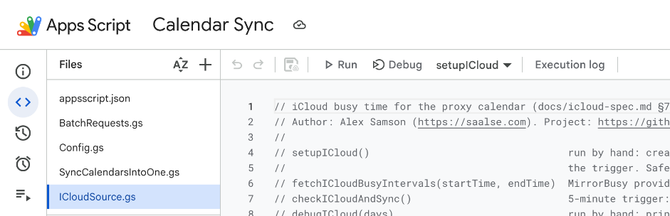
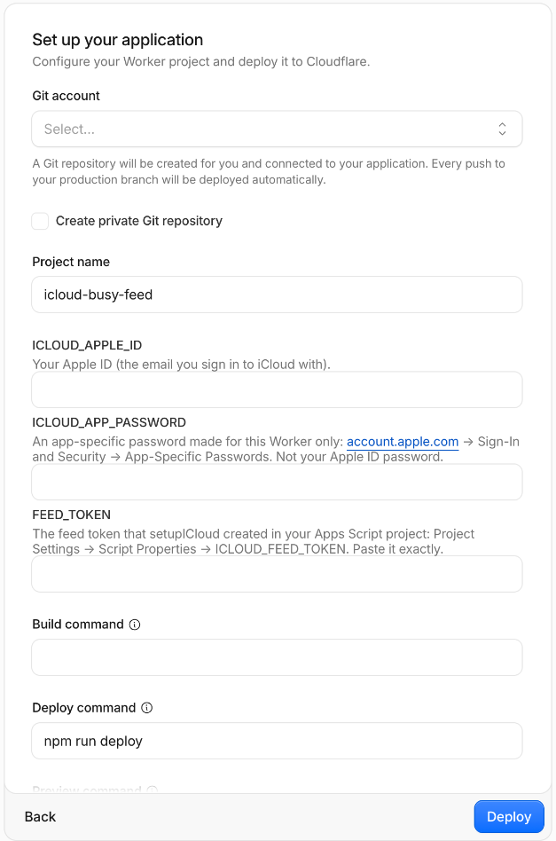

This guide shows busy time from your iCloud calendars in the proxy Google account's primary calendar, as plain
`Busy` events with no details. Booking tools that read only that calendar then see your iCloud commitments.

How it works: a small Cloudflare Worker reads iCloud and returns busy intervals only (no titles, places or
people). `ICloudSource.gs` in your Apps Script project fetches them, and MirrorBusy writes them into the proxy
calendar. Design and every rule: [`icloud-spec.md`](https://saalse-busy-calendars.docs7.io/icloud-spec).

Everything below happens in the browser. Developers who prefer the terminal: [`worker/README.md`](https://github.com/saalse/busy-calendars/blob/main/worker/README.md).

**Before you start:** iCloud reaches the proxy only through **MirrorBusy**. Steps 1–5 work on their own and show
you what would be synced. Step 6 needs MirrorBusy set up first: [`proxy-setup.md`](https://saalse-busy-calendars.docs7.io/proxy-setup).

## What you need

- the Apps Script project from [`setup-ui-based.md`](https://saalse-busy-calendars.docs7.io/setup-ui-based), already working;
- an Apple ID with two-factor authentication (Apple requires it for app-specific passwords);
- a free **Cloudflare** account and a free **GitHub** account (GitLab works too).

About 15 minutes.

## How to run a function in Apps Script

You'll do this several times. In the Apps Script editor:

1. Open **`ICloudSource.gs`** in the file list on the left. The function list only shows functions of the open
   file; with `Config.gs` open it says "No functions".
2. In the toolbar, pick the function (here `setupICloud`) in the drop-down to the right of **Run** and **Debug**.
3. Click **Run**. The **Execution log** opens at the bottom and shows what happened.



## Steps

### 1. Apple: app-specific password

[account.apple.com](https://account.apple.com) → **Sign-In and Security** → **App-Specific Passwords** → create one,
named for example `icloud-busy-feed`. Save it in your password manager right away: Apple shows it only once. Use it
only for this Worker. It is not limited to calendars (Apple also lets it read mail and contacts), which is why it
lives only in your Cloudflare account and never in Google.

### 2. Apps Script: add the iCloud file and settings

Use the same Apps Script project where `SyncCalendarsIntoOne` already runs (the Google account that owns your Busy
Time calendar). If you don't see it at [script.google.com](https://script.google.com), check which Google account
is selected (top right).

1. Click **+** → **Script**, name it `ICloudSource`, and paste the whole of
   [`scripts/ICloudSource.gs`](https://github.com/saalse/busy-calendars/blob/main/scripts/ICloudSource.gs).
2. At the end of `Config.gs`, add these four lines, with your own time zone
   ([IANA name](https://en.wikipedia.org/wiki/List_of_tz_database_time_zones), for example `"Asia/Ho_Chi_Minh"` or
   `"Europe/Berlin"`):
   ```js
   const ICLOUD_FEED_URL = ""
   const ICLOUD_CALENDARS = []
   const ICLOUD_FLOATING_TIMEZONE = "Asia/Ho_Chi_Minh"
   const ICLOUD_DAYS_AHEAD = 30
   ```
3. Save (⌘S / Ctrl+S).

### 3. Apps Script: run `setupICloud` (first time)

Run `setupICloud` as shown [above](#how-to-run-a-function-in-apps-script). Google may ask for permissions; allow
them.

The log says `created the feed token`. Open **Project Settings** (gear icon on the left) → **Script Properties** and
copy the value of `ICLOUD_FEED_TOKEN`. You need it in the next step. It never appears in the log.

### 4. Cloudflare: deploy the Worker

Pick **one** of the two ways.

#### 4a. Deploy button (most people)

The button copies the Worker's code (the `worker/` folder only) into a new repository in your GitHub, because
Cloudflare builds a Worker from a repository you control. Nothing secret goes into that repository; you can make it
private.

1. Open [Deploy to Cloudflare](https://deploy.workers.cloudflare.com/?url=https://github.com/saalse/busy-calendars/tree/main/worker)
   and sign in to Cloudflare (or create a free account; turn on two-factor authentication, since your Apple
   password will live there).
2. You should see **Set up your application** with three fields called `ICLOUD_APPLE_ID`, `ICLOUD_APP_PASSWORD`
   and `FEED_TOKEN`. If after signing in you land on a page that asks you to pick a repository instead, open the
   link from point 1 again: Cloudflare sometimes drops it during sign-in.
3. **Git account:** pick your GitHub account (or connect it). Tick **Create private Git repository** if you like.
4. Keep **Project name** `icloud-busy-feed`. Fill in:
   - `ICLOUD_APPLE_ID`: your Apple ID (email);
   - `ICLOUD_APP_PASSWORD`: the app-specific password from step 1;
   - `FEED_TOKEN`: the `ICLOUD_FEED_TOKEN` value from step 3.
5. Leave the rest as it is and click **Deploy**. The build takes a minute or two.



#### 4b. Connect your own copy of this repository (owners and forks)

If this repository (or your fork of it) is already in your GitHub, build from it instead of making another copy:

1. Cloudflare dashboard → **Workers & Pages** → **Create application** → **Import a repository** → pick the repository.
2. **Project name:** `icloud-busy-feed` (it must match `name` in `worker/wrangler.jsonc`).
3. **Advanced settings** → **Path:** `worker`. **API token:** Create new token.
4. Turn off **Enable Preview builds**. Leave the build command empty and the deploy command as it is.
5. Click **Deploy**. Leave **Variable name / value** empty: those are build-time variables, not the Worker's secrets.
6. When it's deployed: the Worker → **Settings** → **Variables & Secrets** → **Add**, type **Secret**, three times:
   `ICLOUD_APPLE_ID`, `ICLOUD_APP_PASSWORD`, `FEED_TOKEN` (values as in 4a).
7. Optional: **Settings** → **Build** → **Build watch paths** `worker/*`, so that changes elsewhere don't rebuild
   the Worker.

#### Either way

Copy the Worker's address: `https://icloud-busy-feed.<your-subdomain>.workers.dev` (**Workers & Pages** →
`icloud-busy-feed`). Opening it in a browser shows `{"ok":false,"error":"unauthorized"}`. That's correct: only
your Apps Script has the token. If it says `not_configured`, a secret is missing.

### 5. Apps Script: run `setupICloud` again

1. In `Config.gs`, put the address between the quotes:
   `const ICLOUD_FEED_URL = "https://icloud-busy-feed.<your-subdomain>.workers.dev"`. Save.
2. Open `ICloudSource.gs` and run `setupICloud` again.

The log shows the names of your iCloud calendars and every busy interval within the next `ICLOUD_DAYS_AHEAD` days,
in your time zone. Compare a few with Apple Calendar.

By default **all** calendars are read, including calendars other people share with you. Usually you want only the
ones that block your own time: copy their names from the log into `ICLOUD_CALENDARS` (exactly, case and spaces
count), for example `const ICLOUD_CALENDARS = ["Work", "Family"]`, save, and run `setupICloud` again. With more than
10 calendars you have to pick.

### 6. Turn it on in the proxy (after [MirrorBusy is set up](https://saalse-busy-calendars.docs7.io/proxy-setup))

1. If your project shows `appsscript.json` with an `oauthScopes` list (projects pushed with clasp do), add
   `"https://www.googleapis.com/auth/script.scriptapp"` to it, so that setup can create the trigger. Projects made
   in the browser don't need this.
2. In `Config.gs`, add `"fetchICloudBusyIntervals"` to `MIRROR_EXTRA_PROVIDERS`.
3. Open `MirrorBusy.gs`, run `dryRunMirrorBusy` and check what it would add: the log lists the planned `Busy`
   events with their iCloud calendar.
4. Run `setupICloud` once more. This time it also creates the trigger: `checkICloudAndSync` every 5 minutes.
5. Run `SyncCalendarsIntoOne` once.

Never add the proxy's own primary calendar to `CALENDARS_TO_MERGE`, or its Busy events would loop back.

### 7. Test it

**Live test:** create a test event in an iCloud calendar. Within about 5 minutes a `Busy` event with no title
appears in the proxy. Move it, and the Busy event moves. Delete it, and the Busy event disappears.

**Failure test:** in Script Properties, change one character of `ICLOUD_FEED_TOKEN`, run `checkICloudAndSync`,
and check that the log shows the failure and that no proxy event was deleted. Then undo the change.

### 8. After a day: check the Worker's CPU

Cloudflare's free plan allows 10 ms of CPU per request and tolerates occasional overruns. Cloudflare dashboard →
**Workers & Pages** → `icloud-busy-feed` → **Metrics** → Errors → Invocation Statuses: count **Exceeded CPU Time
Limits** (error 1102). In the Apps Script executions, look for `iCloud: FAILED (http …, not JSON)` or
`/version failed`. Occasional failures are harmless: the next check retries, and nothing is deleted in the
meantime. If they are regular, lower `ICLOUD_DAYS_AHEAD` in `Config.gs`, or move to Workers Paid.

## Changing things later

- **New Apple app-specific password:** Cloudflare dashboard → **Workers & Pages** → `icloud-busy-feed` →
  **Settings** → **Variables & Secrets** → edit `ICLOUD_APP_PASSWORD`. Then revoke the old one at account.apple.com.
- **New feed token:** delete `ICLOUD_FEED_TOKEN` in Script Properties, run `setupICloud` (it creates a new one), and
  put the new value into the Worker's `FEED_TOKEN` in the same Cloudflare page. iCloud reads fail in between, so
  nothing gets deleted.
- **Different calendars or time zone:** edit `Config.gs`, run `setupICloud` to check.
- **Worker updates:** your Worker runs from the copy in your GitHub and doesn't change on its own. To take a fix
  from this project, update your copy from it (Cloudflare redeploys on every push to your copy), or delete the
  Worker and deploy again with the button.
- **Turn iCloud off:** remove `"fetchICloudBusyIntervals"` from `MIRROR_EXTRA_PROVIDERS`, set `ICLOUD_FEED_URL = ""`,
  and delete the `checkICloudAndSync` trigger (Apps Script → **Triggers**).

The code keeps four more Script Properties for itself: `ICLOUD_LAST_VERSION`, `ICLOUD_LAST_OK_AT`,
`ICLOUD_LAST_FAILURE_AT`, `ICLOUD_LAST_RUN_AT`. Leave them alone, or delete them all to reset the state.

Never put the Apple ID, the passwords or the token into the repo or a shared file.

## How it behaves

- **Every 5 minutes** `checkICloudAndSync` asks the Worker whether any of your iCloud calendars changed. If so, it
  runs `SyncCalendarsIntoOne`. It also runs a full sync at least once a day.
- **Horizon:** only today and the next `ICLOUD_DAYS_AHEAD` days (default 30) are read. An event further away
  appears once it enters the horizon, at the latest with the next daily sync. iCloud Busy events that have passed
  may be removed from the proxy; booking doesn't need them.
- **When iCloud can't be read** (wrong token, Apple password revoked, iCloud down, a renamed calendar, an event
  the Worker can't parse), the read counts as failed. MirrorBusy then **deletes nothing** from the proxy, not even
  events from your Google calendars, while still adding new ones. The next attempt waits 15 minutes.
- **After 24 hours without a successful iCloud read**, `checkICloudAndSync` fails on purpose, so Google emails you
  about the failing trigger. Run `setupICloud` or `debugICloud` to see why.

## Troubleshooting

`setupICloud` explains the common problems in its log. The table covers the lines you may see later:

| Log line | Meaning | Fix |
|---|---|---|
| `iCloud check: not configured (ICLOUD_FEED_URL is not set in Config.gs)` | step 5 not done | step 5 |
| `iCloud check: fetchICloudBusyIntervals is not in MIRROR_EXTRA_PROVIDERS` | iCloud isn't turned on in MirrorBusy | step 6 |
| `iCloud: FAILED (http 401 unauthorized)` | `ICLOUD_FEED_TOKEN` ≠ the Worker's `FEED_TOKEN` | copy the token again (step 3 → Cloudflare Variables & Secrets) |
| `iCloud: FAILED (http 502 upstream_auth)` | Apple rejected the Apple ID or app password | new app-specific password, see "Changing things later" |
| `iCloud: FAILED (http 500 not_configured)` | a Worker secret is missing | Cloudflare → Variables & Secrets: all three must exist |
| `…: failed (not_found)` | no iCloud calendar has that exact name | run `setupICloud`, copy the name from its list |
| `…: failed (parse_failed)` | the Worker could not read an event in that calendar | Cloudflare → the Worker → Logs; open an issue with the calendar app and event type (never the event itself) |
| `iCloud: FAILED (http 400 bad_request: more than 10 calendars; name them)` | `ICLOUD_CALENDARS` is empty and you have more than 10 | list up to 10 names |
| `iCloud: FAILED (http …, not JSON)` | Cloudflare error page, e.g. error 1102 (CPU limit exceeded) | if regular: step 8 |
| `requested window is outside the iCloud horizon` | the caller asked only for dates beyond `ICLOUD_DAYS_AHEAD` | nothing to fix |
| `iCloud check: backing off …` | a read failed less than 15 minutes ago | wait, or fix the cause above |

---

Author: [Alex Samson](https://saalse.com). Design: [`icloud-spec.md`](https://saalse-busy-calendars.docs7.io/icloud-spec).
